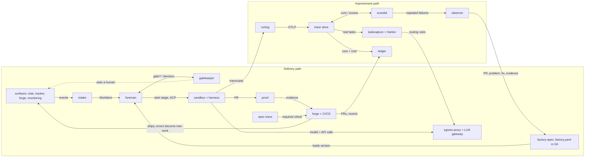

# Components and how they connect

The factory is split into small tools. Each solves one problem alone and connects to the others only through
shared formats. Adopted projects do the heavy lifting; we build only what is specific to a coding-agent
factory.

## Rules for the tool family

1. **Formats connect the tools, not imports.** No module imports another module's code.
2. **Useful alone on day one.** If a tool needs a sibling to be useful, it is part of that sibling.
3. **Files and CLI first, server second.** Every tool works on local files and in CI; a server mode is optional.
4. **Adopt the core, own the adapter.**
5. **Prove it on ourselves first.** Every tool runs in this repository before its first release.
6. **One problem, one name, one release.**

## Wiring

The delivery path ships one change. The improvement path reads every recorded run and changes the factory only
through a reviewed PR to `factory-spec`, which the foreman loads as its next version.

## Five shared formats

| Format | Status | Based on | Carries | Written by → read by |
| --- | --- | --- | --- | --- |
| Factory definition | new | YAML + JSON Schema; prompts as Markdown; tools as MCP | Agents, prompts, skills, MCP servers, secret references, models, runners, stages, gates, automations, scorers, benchmarks | people, observer → foreman, gatekeeper, scorekit, taskcapture |
| Work item event | adopt + small schema | CloudEvents | Type, origin link, requester, product surface, priority, dedupe key | intake → foreman, ledger |
| Run record | adopt | OpenTelemetry GenAI conventions plus factory attributes; Agent Trace for line attribution | Transcript, tool calls, tokens, cost, model, harness, factory version, links | runlog → trace store, scorekit, ledger, taskcapture |
| Evidence bundle | new | Folder with a manifest; Playwright traces, screenshots, video, JUnit | What was verified, against which scenario IDs, with which artifacts and result | proof → forge, spec-trace |
| Score | adopt | Langfuse score model | Scorer, run, result, reason, judge model, cost | scorekit → observer, ledger |

The OpenTelemetry GenAI conventions still have “Development” status. Pin a version.

The schemas, fixtures and pins are in [`contracts/`](../../contracts/README.md#formats); the events between modules
are in [`contracts/events/asyncapi.yaml`](../../contracts/events/asyncapi.yaml).

## Tools to build

| Tool | Tier | Wave | Lang | Useful alone as | Reads → writes | Adopts | Prior art and why we still build | Seed in sesigl/child-apps-company |
| --- | --- | --- | --- | --- | --- | --- | --- | --- |
| factory-spec | core | 1 | TS | One agent config rendered for every harness; `lint`, `diff`, `plan`, `apply` | factory.yaml → harness configs, resolved definition | JSON Schema, gh-aw as an output | Warp's factory format is closed; gh-aw is per-workflow and GitHub-only; AGENTS.md has no schema | `orchestration/workflow.config.json` |
| runlog | core | 1 | TS | Every harness session as an OTel run record | session files, native OTel → OTLP | OTel SDK, Collector, Agent Trace | Viewers exist (Claudescope, agentlogs) but no standard exporter | `scripts/observability/hermes_transcript.py` |
| proof | core | 1 | TS | Evidence on any PR | Playwright JSON, JUnit XML, a running page, a Playwright MCP folder → evidence bundle, PR comment, commit status `proof`; GitHub Action | Playwright, Playwright MCP | Allure and JUnit check actions show reports, not evidence per scenario ID (ADR 0028, ADR 0029) | `qa-scenarios` skill |
| spec-trace | optional | 2 | TS | Scenario ↔ test ↔ PR traceability | features, test ASTs, JUnit XML, evidence bundles, the base commit → check, JSON report with the changes, job summary, GitHub Action | Gherkin parser, ts-morph | Cucumber executes; gherkin-lint sees only feature files; OpenFastTrace is Java and has no steps (ADR 0030, 0031) | `make specs-check`, `traceability-check` |
| scorekit | optional | 2 | TS | Calibrated scorers for coding sessions | run records, scorer files, `ANNOTATION` labels → scores, calibration report, score report, Langfuse scores, Langfuse evaluators | Langfuse score model and evaluators, any OpenAI-compatible gateway | Langfuse, promptfoo and autoevals judge answers, not coding sessions, and report no agreement with labels (ADR 0032, 0033) | — |
| ledger | optional | 2 | SQL+TS | Cost per PR and flow metrics | LiteLLM spend rows or price table, run records, `work.received`, `pr.opened`, `pr.reviewed` and `pr.closed` events, or a GitHub or Forgejo repository's pull requests → DuckDB or PostgreSQL views, JSON, Markdown and HTML report, Grafana dashboard, `pr.*` events | DuckDB, PostgreSQL, Grafana, LiteLLM spend logs and price table | DevLake and Four Keys measure flow but not agent cost; LiteLLM knows spend but not pull requests (ADR 0034, 0035, 0036, 0044) | metrics pipeline (ADR 0029) |
| taskcapture | optional | 3 | TS | Private benchmark from merged PRs; routing rules | merged GitHub or Forgejo PR or a run record → Harbor task with hidden tests; suite → one `harbor run` per configuration; Harbor trial results → correctness-versus-cost report, LiteLLM tag routing config | Harbor, LiteLLM | Harbor runs tasks but does not create them from history; SWE-bench mines public GitHub only (ADR 0043, 0045) | — |
| observer | optional | 3 | TS | Reviewed fixes to agent instructions and the factory, with before/after check | scores and run records → problems; a problem and instruction files → pull request with Problem, Solution and Evidence; scores and a merged pull request → before/after verdict | any OpenAI-compatible gateway, GitHub and Forgejo pull requests; backpass's evidence gate | backpass edits AGENTS.md from local transcripts; it lacks scores, pull requests and a before/after check (ADR 0046) | `agent-cleaner` agent |
| gatekeeper | core | 3 | TS | Rule-based approvals for any automation | request or pull request + Rego policy → approval request in Slack or a pull request comment; decision → signed record, commit status, `gate.*` events; `serve`: the HTTP API, Slack events and buttons, a Postgres outbox | OPA (CLI), the channel port (slack) and the forge port (github, forgejo) as adapter programs, Fastify, PostgreSQL | manual-approval blocks a runner and has no policy; HumanLayer needs its hosted service (ADR 0047, 0048, 0062) | `controls.json`, `wf.sh pr merge` |
| intake | optional | 4 | TS | One inbox for agent work; Factory MCP server | submissions over HTTP, Slack mentions through the channel port (slack), issues labeled `factory` through the forge port, fatal Sentry alerts, a local agent over MCP → work items with every origin, joined across surfaces by an issue's link, `work.received@v1` through a Postgres outbox | the channel and forge ports as adapter programs, MCP SDK, Fastify, PostgreSQL or PGlite, NATS | n8n and Huginn route events but have no work item or dedupe key; Plane's intake lives inside a tracker; Keep deduplicates alerts, not work (ADR 0063, 0065) | — |
| foreman | core | 4 | TS | Run declared multi-agent pipelines with gates | work items (HTTP or `work.received@v1`) + `factory.yaml` at a commit → one Temporal workflow per run: each stage's agent through the harness port, gate requests to gatekeeper, `gate.decided@v1` in, steering and cancel, `run.started@v1` and `run.completed@v1`; a stage whose agent declares a sandbox runs in a fresh one through the sandbox port; a stage with `checks` waits for them on the run's pull request through the forge port; one inference gateway per factory with a key per run; a person takes over a running stage and hands the run back | Temporal, the harness port (ACP), the sandbox, forge and inference ports as adapter programs, Fastify, NATS | OpenHands covers much as one product; stay thin and support it as a harness; Argo and Tekton have no human gates or steering (ADR 0004, 0067, 0068, 0069, 0070) | `scripts/workflow/wf/next_action.py` |

Plus `contracts` and `testkit` (core, wave 0) and the `open-software-factory` distribution (wave 4). Libraries in
`packages/` hold code that several modules share, without a CLI or state of their own (ADR 0039): `cli` runs the
commands of a module (ADR 0040), `spec-files` reads feature files and JUnit reports (ADR 0042). The reader of run
records, `runSpans`, lives in `contracts` (ADR 0041).

## Adopt, don't rebuild

| Need | Adopt | Alternatives | Interface |
| --- | --- | --- | --- |
| Coding harness | Claude Code, Codex, OpenCode, Gemini CLI | OpenHands, Goose, Aider | Agent Client Protocol (ACP); Coder's agentapi as fallback |
| Sandbox | kubernetes-sigs/agent-sandbox with gVisor or Kata; Docker for one machine (ADR 0054) | E2B, Daytona | sandbox port |
| Secrets out of the sandbox | iron-proxy | agentgateway, Cloak | egress proxy swapping placeholder tokens |
| Secret storage | OpenBao | Vault, Infisical | secret references |
| MCP gateway | iron-proxy's MCP policy in each sandbox (ADR 0054) | agentgateway | MCP with per-agent tool allowlists |
| Inference gateway | LiteLLM with PostgreSQL, run by the `litellm` inference adapter (ADR 0056) | agentgateway; Bedrock, Vertex behind it | OpenAI-compatible endpoint, routing config, keys with budgets, spend rows |
| Durable workflows | Temporal | DBOS | workflows and signals |
| Chat and tracker adapters | Vercel Chat SDK through the `slack` and `github` channel adapters (ADR 0059) | native webhooks | channel port; a mention as a work item; replies and approval cards in its thread |
| Forge | Forgejo's REST API v1 through the `forgejo` forge adapter (ADR 0057); GitHub's REST API through the `github` forge adapter (ADR 0058) | GitLab | forge port; commit statuses as checks; webhook deliveries as `pr.*` events |
| Trace store and judges | Langfuse | Arize Phoenix | OTLP, score API |
| Benchmark runner | Harbor | Inspect | Harbor task format and CLI; optional Python agent plugin (ADR 0009) |
| Code attribution | Agent Trace | — | trace records |
| Browser verification | Playwright, Playwright MCP | browser-use, Stagehand | traces, video |
| Policy | OPA | Cedar | policy files |
| Agent memory | choose later | Graphiti, mem0, Letta | MCP server |
| Dashboards | Grafana | Langfuse dashboards | SQL views |
| GitHub-only teams | gh-aw | — | factory-spec renders it |

## Value from combinations

| Combination | Capability |
| --- | --- |
| runlog | See every agent session in one place |
| + scorekit | Know where agents waste time and money |
| + observer | Instructions that improve themselves through reviewed PRs |
| runlog + ledger | Cost per PR by source, person, agent, model |
| taskcapture + Harbor + LiteLLM | Model choice by evidence, applied as routing |
| proof + spec-trace | PRs that prove they meet named scenarios |
| factory-spec + foreman + gatekeeper + intake | The delivery loop with human gates |
| all | The open software factory |

## Release waves

| Wave | Goal | Modules |
| --- | --- | --- |
| 0 | Foundation | repository tooling, contracts, testkit |
| 1 | Record | factory-spec, runlog, proof |
| 2 | Measure | scorekit, ledger, spec-trace |
| 3 | Improve | taskcapture, observer, gatekeeper |
| 4 | Automate | intake, foreman, distribution |
