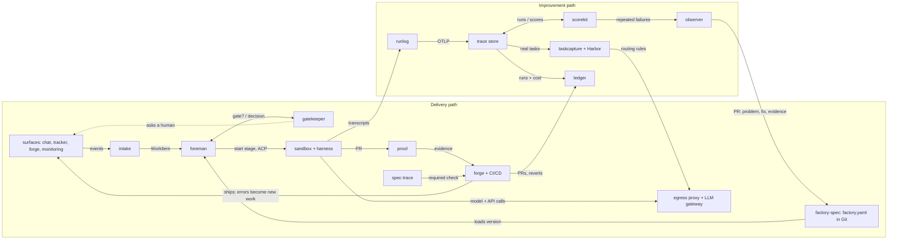

# Components and how they connect

The factory is split into small tools. Each solves one problem alone and connects to the others only through
shared formats. Adopted projects do the heavy lifting; we build only what is specific to a coding-agent
factory.

## Rules for the tool family

1. **Formats connect the tools, not imports.** No module imports another module's code.
2. **Useful alone on day one.** If a tool needs a sibling to be useful, it is part of that sibling.
3. **Files and CLI first, server second.** Every tool works on local files and in CI; a server mode is optional.
4. **Adopt the core, own the adapter.**
5. **Prove it on ourselves first.** Every tool runs in this repository before its first release.
6. **One problem, one name, one release.**

## Wiring

The delivery path ships one change. The improvement path reads every recorded run and changes the factory only
through a reviewed PR to `factory-spec`, which the foreman loads as its next version.

## Five shared formats

| Format | Status | Based on | Carries | Written by → read by |
| --- | --- | --- | --- | --- |
| Factory definition | new | YAML + JSON Schema; prompts as Markdown; tools as MCP | Agents, prompts, skills, MCP servers, secret references, models, runners, stages, gates, automations, scorers, benchmarks | people, observer → foreman, gatekeeper, scorekit, taskcapture |
| Work item event | adopt + small schema | CloudEvents | Type, origin link, requester, product surface, priority, dedupe key | intake → foreman, ledger |
| Run record | adopt | OpenTelemetry GenAI conventions plus factory attributes; Agent Trace for line attribution | Transcript, tool calls, tokens, cost, model, harness, factory version, links | runlog → trace store, scorekit, ledger, taskcapture |
| Evidence bundle | new | Folder with a manifest; Playwright traces, screenshots, video, JUnit | What was verified, against which scenario IDs, with which artifacts and result | proof → forge, spec-trace |
| Score | adopt | Langfuse score model | Scorer, run, result, reason, judge model, cost | scorekit → observer, ledger |

The OpenTelemetry GenAI conventions still have “Development” status. Pin a version.

The schemas, fixtures and pins are in [`contracts/`](../../contracts/README.md#formats); the events between modules
are in [`contracts/events/asyncapi.yaml`](../../contracts/events/asyncapi.yaml).

## Tools to build

| Tool | Tier | Wave | Lang | Useful alone as | Reads → writes | Adopts | Prior art and why we still build | Seed in sesigl/child-apps-company |
| --- | --- | --- | --- | --- | --- | --- | --- | --- |
| factory-spec | core | 1 | TS | One agent config rendered for every harness; `lint`, `diff`, `plan`, `apply` | factory.yaml → harness configs, resolved definition | JSON Schema, gh-aw as an output | Warp's factory format is closed; gh-aw is per-workflow and GitHub-only; AGENTS.md has no schema | `orchestration/workflow.config.json` |
| runlog | core | 1 | TS | Every harness session as an OTel run record | session files, native OTel → OTLP | OTel SDK, Collector, Agent Trace | Viewers exist (Claudescope, agentlogs) but no standard exporter | `scripts/observability/hermes_transcript.py` |
| proof | core | 1 | TS | Evidence on any PR | Playwright JSON, JUnit XML, a running page, a Playwright MCP folder → evidence bundle, PR comment, commit status `proof`; GitHub Action | Playwright, Playwright MCP | Allure and JUnit check actions show reports, not evidence per scenario ID (ADR 0028, ADR 0029) | `qa-scenarios` skill |
| spec-trace | optional | 2 | TS | Scenario ↔ test ↔ PR traceability | features, tests, results → report, check | Gherkin parser | Cucumber executes; nothing lints ID traceability | `make specs-check`, `traceability-check` |
| scorekit | optional | 2 | TS | Calibrated scorers for coding sessions | run records → scores | Langfuse evaluators | Platforms have judges, not coding-session scorers or calibration | — |
| ledger | optional | 2 | SQL+TS | Cost per PR and flow dashboard | gateway spend, runs, forge events → views, dashboards | Postgres, DuckDB, Grafana | DORA tools lack agent cost | metrics pipeline (ADR 0029) |
| taskcapture | optional | 3 | TS | Private benchmark from merged PRs; routing rules | PR + run → Harbor task; results → report, LiteLLM config | Harbor | Harbor runs tasks but does not create them from history | — |
| observer | optional | 3 | TS | Reviewed fixes to agent instructions and the factory, with before/after check | scores, runs, definition → PR, report | backpass (for AGENTS.md edits) | backpass edits AGENTS.md; lacks scores, full definition, before/after | `agent-cleaner` agent |
| gatekeeper | core | 3 | TS | Rule-based approvals for any automation | change + policy → request; decision → signed record | OPA or Cedar, Chat SDK | check human-approval SDKs before building | `controls.json`, `wf.sh pr merge` |
| intake | optional | 4 | TS | One inbox for agent work; Factory MCP server | webhooks → work item events | Vercel Chat SDK, MCP SDK | — | — |
| foreman | core | 4 | TS | Run declared multi-agent pipelines with gates | work items + definition → sandbox runs, gate requests | Temporal, agent-sandbox, ACP, agentapi | OpenHands covers much as one product; stay thin and support it as a harness | `scripts/workflow/wf/next_action.py` |

Plus `contracts` and `testkit` (core, wave 0) and the `open-software-factory` distribution (wave 4).

## Adopt, don't rebuild

| Need | Adopt | Alternatives | Interface |
| --- | --- | --- | --- |
| Coding harness | Claude Code, Codex, OpenCode, Gemini CLI | OpenHands, Goose, Aider | Agent Client Protocol (ACP); Coder's agentapi as fallback |
| Sandbox | kubernetes-sigs/agent-sandbox with gVisor or Kata | E2B, Daytona; Docker locally | sandbox port |
| Secrets out of the sandbox | iron-proxy | agentgateway, Cloak | egress proxy swapping placeholder tokens |
| Secret storage | OpenBao | Vault, Infisical | secret references |
| MCP gateway | agentgateway | — | MCP with per-agent allowlists |
| Inference gateway | LiteLLM | agentgateway; Bedrock, Vertex behind it | OpenAI-compatible endpoint, routing config |
| Durable workflows | Temporal | DBOS | workflows and signals |
| Chat, tracker and forge adapters | Vercel Chat SDK | native webhooks | bot handlers |
| Trace store and judges | Langfuse | Arize Phoenix | OTLP, score API |
| Benchmark runner | Harbor | Inspect | Harbor task format and CLI; optional Python agent plugin (ADR 0009) |
| Code attribution | Agent Trace | — | trace records |
| Browser verification | Playwright, Playwright MCP | browser-use, Stagehand | traces, video |
| Policy | OPA | Cedar | policy files |
| Agent memory | choose later | Graphiti, mem0, Letta | MCP server |
| Dashboards | Grafana | Langfuse dashboards | SQL views |
| GitHub-only teams | gh-aw | — | factory-spec renders it |

## Value from combinations

| Combination | Capability |
| --- | --- |
| runlog | See every agent session in one place |
| + scorekit | Know where agents waste time and money |
| + observer | Instructions that improve themselves through reviewed PRs |
| runlog + ledger | Cost per PR by source, person, agent, model |
| taskcapture + Harbor + LiteLLM | Model choice by evidence, applied as routing |
| proof + spec-trace | PRs that prove they meet named scenarios |
| factory-spec + foreman + gatekeeper + intake | The delivery loop with human gates |
| all | The open software factory |

## Release waves

| Wave | Goal | Modules |
| --- | --- | --- |
| 0 | Foundation | repository tooling, contracts, testkit |
| 1 | Record | factory-spec, runlog, proof |
| 2 | Measure | scorekit, ledger, spec-trace |
| 3 | Improve | taskcapture, observer, gatekeeper |
| 4 | Automate | intake, foreman, distribution |
