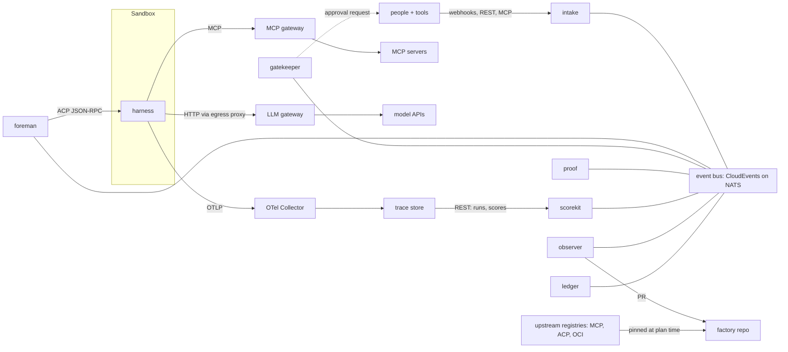

# Internals: adapters, factory as code, loops, communication

## Ports and adapters

Each module defines a small interface (a port) for every outside system. An adapter implements one port for
one product and must pass the port's `@conformance` scenarios in `ports/<port>/features/`. Abstract only where
users really differ: the workflow engine (Temporal) stays fixed.

Inside a module, `architecture.json` lists its layers from top to bottom, and the ARCH check keeps every import
pointing down (ADR 0014). The template starts with `entry` → `adapters` → `domain`, so domain code never imports
an adapter.

| Port | Interface | Example adapters |
| --- | --- | --- |
| harness | ACP on stdio (ADR 0050): start · send · stream events · approve tool · cancel; plus a tool allowlist, cancel within 5 seconds and the transcript export as a run record | **acp** (generic, any agent in the ACP Registry; an ACP proxy, `adapters/harness/acp`); **claude-code** (the ACP bridge `claude-agent-acp` behind the proxy library `packages/harness-proxy`, mode `default`, its own settings folder, tokens and cost from ACP; ADR 0052); **codex** (the ACP bridge `codex-acp` behind the proxy library, mode `read-only`, its own `CODEX_HOME`, steering by `_session/steering`, tokens from ACP; ADR 0053); **opencode** (`opencode acp` behind the proxy library, every tool but reading asks, its own XDG folders, no folder config, tokens from ACP; ADR 0053); **agentapi** fallback for terminal-only agents; **scripted** (the testkit's scripted agent behind `acp`, deterministic; ADR 0052) |
| sandbox | a command line (ADR 0054): create(sandbox spec) · exec · copy · snapshot · destroy · list · egress log; every request leaves through the sandbox's egress proxy, iron-proxy, which refuses other hosts, swaps secret placeholders and allows only the declared MCP tools | **docker** (a container on an internal network behind an iron-proxy container, `adapters/sandbox/docker`; ADR 0054); **kubernetes** (an agent-sandbox SandboxClaim behind an iron-proxy egress pod, `adapters/sandbox/kubernetes`; ADR 0055; gVisor or Kata through the template); e2b, daytona (community); macOS VM runner |
| channel | a command line (ADR 0059): receive (a delivery as a work item or a decision) · reply(thread, text) · ask(thread, question, choices) → an approval card | **slack** (threads, Block Kit buttons, `adapters/channel/slack`), **github** (the conversation of a pull request, a card answered with `/<choice>`, `adapters/channel/github`); both through Vercel Chat SDK; teams (Adaptive Cards, tenant consent), linear (agent sessions); jira and sentry through webhooks |
| tracker | create · update state · link PR · comment | github issues, linear, jira |
| forge | a command line (ADR 0057): branch · open-pr · pr (merge state) · check (a commit status) · comment · protect (merge rules) · merge · webhook · event (a delivery as `pr.opened`, `pr.reviewed` or `pr.closed`) | **forgejo** (Forgejo's REST API v1, `adapters/forge/forgejo`; also the deterministic test forge; ADR 0057); **github** (GitHub's REST API, `adapters/forge/github`, tested against the testkit's `fakes.github`; ADR 0058); gitlab |
| inference | a command line (ADR 0056): start(config) · key(run, budget) · spend log · stop · list; the gateway's OpenAI-compatible chat completions API routes aliases and tags to models, refuses a run over its budget and logs every call with `osf.run.id` | **litellm** (the LiteLLM proxy with PostgreSQL on Docker in front of any provider, `adapters/inference/litellm`; ADR 0056) |
| secrets | resolve(reference) at the egress proxy, never in the sandbox (`ports/secrets/README.md`) | **file** (`OSF_SECRETS_DIR`; ADR 0054), **env** (`OSF_SECRET_<NAME>`), **openbao** (KV v2), all resolved by both sandbox adapters (ADR 0055); vault, infisical |
| telemetry | OTLP | **otlp** via the OpenTelemetry Collector to any backend |
| policy | decide(input) → allow, deny or gate | **opa**, cedar |
| benchmark environment | Harbor environment | docker, daytona, modal, e2b (all in Harbor) |

Docker Compose and Helm are not sandbox adapters; they install the factory itself.

## Everything in code

We do not invent a language. `factory.yaml` with a JSON Schema, plus Markdown prompts and skills, plus Rego
policies, in one Git repository. We copy Terraform's four pillars:

| Pillar | Terraform | Factory |
| --- | --- | --- |
| Desired state | HCL in Git | `factory.yaml`, prompts, skills, policies; secrets only as references |
| Providers | plugins pinned in a lock file | adapters declared in `providers:`, pinned in `factory.lock` with versions and image digests |
| Plan, apply, drift | `plan`, `apply`, state | `factory plan` shows changes; `factory apply` registers webhooks, writes harness configs, sets gateway routes, upserts scorers; nightly plan reports drift |
| Modules | reusable blocks | stage packs, for example `osf/modules/code-review@1.2` |

Every run records the hash of the factory version it ran on.

```yaml
# Illustrative
version: 1
factory: web-app
providers:
  harness:   { claude-code: "^2", codex: "^1" }
  sandbox:   { kubernetes: "^0.4" }
  channel:   { slack: "^1", github: "^1" }
  inference: { litellm: "^1" }
agents:
  triage:
    harness: claude-code
    model: routes/triage            # routing rule, not a fixed model
    prompt: ./agents/triage.md
    mcp: [registry:io.github/github@1.4, linear@2]
    secrets: [ref:openbao/linear-token]
    sandbox: { template: small, egress: [api.linear.app] }
  implement:
    harness: codex
    model: routes/implement
    prompt: ./agents/implement.md
    skills: [./skills/testing]
    sandbox: { template: node-24, cpu: 4, memory: 8Gi }
workflow:
  - stage: triage
  - stage: spec
    gate: { policy: ./policy/spec.rego }
  - stage: implement
  - stage: review
  - stage: verify
    evidence: required
automations:
  - on: github.issue.labeled(auto-implement)
  - on: sentry.fatal
  - cron: "0 10 * * *"
    run: self-triage-report
scorers:
  redundant-tests: { sample: 0.2, judge: ./scorers/redundant-tests.md }
```

Two ways to apply it: **CLI reconcile** (`factory plan` and `apply` from CI; Docker Compose install) and a
**Kubernetes operator mode** (`factory render --k8s` writes kagent Agent, ModelConfig and MCPServer resources and
agent-sandbox templates; Argo CD or Flux applies them). An OpenTofu provider can come later as an add-on.

## Three nested loops

| Loop | Time scale | Engine | Steps |
| --- | --- | --- | --- |
| Inner (harness) | seconds to minutes | the harness | build context → model answers with text or tool calls → permission check → run tools (read, edit, shell, MCP) → results into context, compact when large → repeat until done, budget or interruption |
| Outer (delivery) | hours | foreman on Temporal | each stage is an activity that starts an inner loop in a fresh sandbox; deterministic checks between stages; gates wait for gatekeeper signals; steering and handoff are signals; sub-agents are child workflows |
| Meta (improvement) | days | scorekit, observer, taskcapture | score sampled runs → group repeated failures → PR to the factory → benchmark it → person merges → foreman loads new version → same scorer checks the effect |

### OpenTelemetry support of harnesses (October 2026)

| Harness | Status | Notes |
| --- | --- | --- |
| Gemini CLI | native | logs, metrics, traces; reported to follow GenAI conventions |
| Codex CLI | native | logs and traces via `[otel]`; internal span names; conversation as span events; prompt text off by default |
| Claude Code | traces in beta | metrics and log events native; traces need `CLAUDE_CODE_ENHANCED_TELEMETRY_BETA` and `OTEL_TRACES_EXPORTER` |
| OpenCode | experimental | OTLP traces behind a flag; plugins; storage moved to SQLite, so runlog reads `opencode export` |
| Goose and others | not checked | fall back to session files |

Verify names against vendor docs before writing an adapter. runlog makes telemetry uniform in three steps:
1. **Correlate at launch:** the foreman sets
   `OTEL_RESOURCE_ATTRIBUTES=osf.factory.version=…,osf.work_item.id=…,osf.run.id=…,osf.stage=…`. The attribute names
   and the pinned GenAI conventions are in [`contracts/run-record/`](../../contracts/run-record/run-record.schema.json).
2. **Normalize in the Collector:** a per-harness mapping renames spans to the GenAI conventions (runlog's
   [Collector config pack](../../modules/runlog/README.md#collector-config-pack), ADR 0025).
3. **Complete from the session file:** the foreman also sets a W3C `TRACEPARENT`; when the stage ends,
   `runlog attach` exports the session file into that trace with the outcome of the stage (ADR 0024).

## Communication



| Protocol | Job | Where |
| --- | --- | --- |
| MCP | what a model can call | tools inside the sandbox through the MCP gateway; Factory MCP server for outside agents; optional MCP faces of tools |
| ACP | drive a harness | foreman → harness |
| REST (OpenAPI) | commands between programs | every module's server mode; generated TypeScript types (the only client, ADR 0012) |
| CloudEvents on a bus | facts others react to | NATS JetStream; webhooks when there is no bus; events are past tense and versioned (`run.completed@v1`) |
| OTLP | telemetry | harnesses, gateways and modules to the Collector |
| A2A | agents of other organizations | later only |

### Registries: consult, pin, don't build

| Catalog | Holds | Status (Oct 2026) | Use |
| --- | --- | --- | --- |
| MCP Registry | MCP servers | live, preview, API v0.1 | reference `registry:<name>@<version>`; organizations may run an approved list in front |
| ACP Registry | harnesses | live since January 2026 | pin harnesses by registry ID |
| OCI registry | images, packaged agents, modules | mature | pin by digest in `factory.lock` |
| A2A agent cards | remote agents | registry in progress | later |
| the factory repository | what actually runs | ours | the only registry that decides; `factory plan` resolves and pins |
